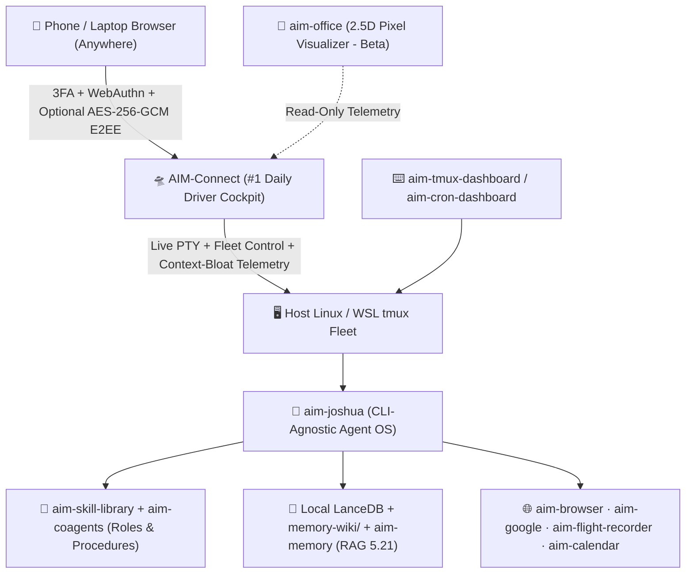

# A.I.M. Ecosystem

**Own your stack. Don't rent a seat.**

**A.I.M. (*Actual Intelligent Memory*)** is a self-hosted, open-source software ecosystem for running, supervising, and auditing long-horizon AI coding agents on your own hardware—from any browser or phone—without SaaS seat fees, vendor lock-in, or context-compression amnesia.

> [!IMPORTANT]
> **Radical Product-Truth Policy (Work in Progress):** This ecosystem is built in the trenches by a working operator to run real daily businesses—not by a VC-funded marketing team. Every repository below carries its **actual build maturity and internal `aim-auditor` grade**. Some tools are battle-tested daily drivers (`aim-connect`, `aim-joshua`), some are active betas or partial phases (`aim-office`, `aim-calendar`), and some are unbuilt architectural specs (`aim-boardroom`, `0` lines of code). Nothing here pretends to be finished when it isn't.

---

## 🧠 Why This Ecosystem Exists (The Engineering Logic)

Most AI developer tools make the same three mistakes: they lock your workflow inside one vendor's `$20–$200/month` subscription, burn API tokens using LLMs to summarize their own messy logs, and trust black-box "context compression" that lobotomizes the agent halfway through a task.

A.I.M. was built from five opposite first principles:

1. **Clientless Sovereignty Over Rented Cloud Seats:** You shouldn't need a `$40/month` cloud IDE, a proprietary desktop app, or private SSH keys stored on a borrowed iPad to control your own Linux server. With **[aim-connect](https://github.com/BrianV1981/aim-connect)**, any mobile or desktop browser becomes a 3FA/WebAuthn-secured root cockpit for your entire `tmux` agent fleet.
2. **The 30% Context Rule (Handoffs Over "Compression"):** A 1M–2M token context window is a trap—past ~30% capacity, attention weights dilute, token burn compounds every turn, and running `/compact` destroys exact variable and architectural recall. Instead of compressing bloated sessions, A.I.M. tracks context bloat visually, curates conscious plain-text Markdown wikis (`memory-wiki/`), and passes tight `HANDOFF.md` batons to fresh `<10%`-context sessions.
3. **Zero-Token Determinism ("Python for Autonomic Work, LLMs for Reasoning"):** An LLM should never do a job that deterministic Python, SQLite `FTS5`, or `git` can do for `$0` in `5ms`. Transcript parsing (`aim-flight-recorder`), local hybrid vector+BM25 recall (`aim-memory` / `mcp_lancedb.py`), and `git worktree` sandboxing happen outside the prompt window—zero background API burn, zero summarizer hallucinations.
4. **Harness Independence (Surviving Vendor Rug-Pulls):** After watching vendors restrict CLI access overnight and spike API pricing without warning, A.I.M. consolidated four separate CLI forks into **[aim-joshua](https://github.com/BrianV1981/aim-joshua)**—a harness-agnostic "Operating Procedure System" that wraps *whichever* CLI or IDE is best today (`Antigravity`, `OpenCode`, `Grok`, `Codex`) behind one shared memory, skill, and GitOps layer.
5. **Adversarial Verification Over Agent "Trust Me" Claims:** Autonomous agents routinely claim tests pass when they haven't run them. A.I.M. seals raw session transcripts into an Operator-only encrypted **Blackbox Vault** and pairs builder agents with a separate hostile **`aim-auditor`** peer (`aim-coagents` + `aim-skill-library`) that grades repositories empirically (`F` → `A+`) before work is accepted.

---

## ⭐ #1 Flagship Daily Driver: [AIM-Connect](https://github.com/BrianV1981/aim-connect)

> **Status:** `🟢 Daily Driver (v1.8.0)` · **Internal Audit:** `Grade A− (160/160 pytest)` · **License:** `MIT` · **Cost:** `$0` (Self-Hosted)

If you only look at one repository in this ecosystem, start with **[aim-connect](https://github.com/BrianV1981/aim-connect)**. It is the top-used tool in the stack every single day—turning any desktop or mobile web browser into a sovereign, zero-install command center for your Linux machine and every autonomous CLI agent running inside `tmux`.

### What Works Today (`v1.8.0`)
- **Clientless Browser SSH & Immortal `tmux` Streams:** Close Safari or Chrome on your phone, drive across town, reopen the PWA, and re-attach to the exact live PTY stream—no SSH keys on client devices and no App Store terminal required.
- **Live AI Fleet Sidebar & Alert Chimes:** Supervise concurrent `Claude`, `Codex`, `OpenCode`, `Grok`, and `Antigravity` sessions with live state detection (`THINKING`, `✋ Waiting` input chimes, `ERROR`, `IDLE`), `Cmd+K` teleportation, and a secret-redacting scrollback **Token Grabber**.
- **Split-Pane Monaco Web IDE, Diff Viewer, & Cross-Fleet Forensics:** Browse files, edit code with `HTTP 409` `mtime` conflict protection, inspect side-by-side Git diffs without unmounting your live terminal, and run instant SQLite `FTS5` searches across structured agent transcripts.
- **Hands-Free `🔊` Neural TTS & Sovereign Mobile Input:** Listen to plain-English spoken agent summaries while away from your desk (`piper-tts` offline ONNX or Edge Neural voices) and type effortlessly on phones using a custom developer keybar (`Tab`, `Esc`, sticky `Ctrl`, pipes) plus programmable voice macros.
- **Zero-Trust 3FA, Passkeys, Client-Side E2EE, & `bwrap` Gateway:** Protected by Stealth Passphrase + Password + TOTP, FIDO2 WebAuthn (**FaceID / TouchID / YubiKey**), optional browser-side `AES-256-GCM` WebSocket encryption, and a multi-tenant Bubblewrap (`bwrap`) sandbox gateway mode.

> [!NOTE]
> **🚧 Active Roadmap (Coming Next to `aim-connect`):** Deeper **Fleet Control** orchestration menus (batch dispatch, lifecycle controls, and multi-agent routing) and richer **Visual Context-Bloat Menus** so you can spot token burn, session saturation, and 30%-Rule handoff thresholds across every running agent at a glance before quality degrades.

### How `aim-connect` Compares to Paid & Existing Alternatives

| Capability | **AIM-Connect** (`MIT`) | **Termius Pro / Blink** (Paid SSH Apps) | **GitHub Codespaces / Coder** (Cloud IDEs) | **Cursor / Vendor Remote** (Locked IDEs) |
| :--- | :--- | :--- | :--- | :--- |
| **Price** | **$0** (100% self-hosted) | `$10–$20/mo` subscription | `$0.18–$0.72/hr` VM compute | `$20–$200/mo` seat + lock-in |
| **Works on Any Borrowed Browser (Zero Install)** | **Yes** (Clientless Web / PWA + 3FA/Passkey) | **No** (Requires native app + local SSH keys) | **Yes** (Cloud hosted) | **No** (Requires vendor desktop/mobile ecosystem) |
| **Multi-CLI AI Fleet Awareness** | **Yes** (`THINKING`/`✋ Waiting` chimes, 30% meters, FTS5 forensics) | **No** (Raw dumb terminal only) | **No** (Single container focus) | **Locked to 1 vendor's agent** |
| **Built-In Split Monaco IDE + Side-by-Side Diff** | **Yes** (Runs against your bare-metal disk) | **No** (SFTP file list only) | **Yes** (Cloud VM disk) | **Yes** (Desktop heavy) |
| **Mobile Dev Keyboard + `🔊` Neural TTS Readback** | **Yes** (Offline Piper ONNX + ghost-free keybar) | Keybar only (no agent TTS) | Poor on mobile browsers | **No** |
| **Browser-to-Host `AES-256-GCM` WS E2EE** | **Yes** (Opaque even to your TLS tunnel) | SSH transport | Vendor terminates TLS | Vendor terminates TLS |

---

## 🧬 Core Foundation: [J.O.S.H.U.A. (`aim-joshua`)](https://github.com/BrianV1981/aim-joshua)

> **Status:** `🟢 Production (v1.1.3 — Deployed Across 21/21 Local Workspaces)` · **Internal Audit:** `Grade A+ (66/66 pytest, Linux + Windows CI)` · **License:** `MIT`

**[aim-joshua](https://github.com/BrianV1981/aim-joshua)** (*Joint Operational Systems for Heuristic User Automation*) is the CLI-agnostic "Operating Procedure System" that sits quietly inside any git repository (`joshua_os/` + `./aim` — automatically `.gitignore`-shielded so it never pollutes your project's commits). Instead of acting as yet another LLM chat loop, it gives *any* CLI or desktop IDE agent persistent local memory, GitOps guardrails, and session continuity:

- **Two-Tier Local Hybrid Memory (`mcp_lancedb.py` + `./aim search`):** Exposes workspace-scoped LanceDB vector + lexical recall natively over MCP (for desktop IDEs on Windows 10/11, macOS, and Linux) with an automatic CLI fallback (`0.5s` offline fallback if local Ollama isn't running).
- **Conscious GitOps Memory (`memory-wiki/` + `.parquet` Datajacks):** Replaces hallucinatory background summarizers with agent-curated Markdown wikis and portable Apache Arrow `.parquet` knowledge cartridges (`bake`, `jack-in`, `unplug`).
- **Worktree Isolation & Forensic Blackbox Vault:** Enforces isolated `aim fix <issue>` worktrees (`workspace/issue-<id>` → `aim promote`) and seals tamper-evident raw session transcripts into an Operator-keyring-encrypted vault (`./aim <vessel>-blackbox`).

| Capability | **J.O.S.H.U.A. (`aim-joshua`)** | **Claude Code / Cursor** (Proprietary) | **OpenHands / Hosted Harnesses** | **Aider / Single-CLI Loops** |
| :--- | :--- | :--- | :--- | :--- |
| **Pricing & Upsell** | **$0** (`MIT`, zero cloud gateway upsell) | `$20–$200/mo` subscription | Free local Docker / `$20+/mo` Cloud | `$0` (`Apache/MIT`, BYOK) |
| **Swap Underlying CLI / Model Anytime** | **Yes** (`Antigravity`, `OpenCode`, `Grok`, `Codex` share 1 brain) | **No** (Vendor-locked) | Tied to OpenHands runtime | Tied to single harness loop |
| **Long-Horizon Memory Strategy** | **Local LanceDB + Git-diffable `memory-wiki/` + `<30%` Baton Pass** | Opaque `/compact` summarization + flat `CLAUDE.md` | Session/container scoped | Repo-map AST (no semantic wiki/vault) |
| **Anti-Tampering Transcript Proof** | **Yes** (Write-only encrypted Blackbox Vault) | **No** | **No** | **No** |
| **Non-Invasive Consumer Repo Shield** | **Yes** (Auto-gitignored `joshua_os/` + atomic `./aim update`) | Leaves `.cursor/` / `.claude/` config | Heavy Docker daemon footprint | `.aider*` dotfiles |

---

## 🛠️ Active Ecosystem Tools: Honest Status & Comparisons

Every active repository in the stack is grouped below by what job it solves, its **real completion state**, and how it compares to paid SaaS and existing open-source tools.

### 1. Fleet Cockpits, Schedulers & Visualizers

| Tool | Real Status | Replaces (Paid SaaS) | Replaces (Existing OSS) | Why Use A.I.M. / Honest Caveat |
| :--- | :--- | :--- | :--- | :--- |
| **[aim-tmux-dashboard](https://github.com/BrianV1981/aim-tmux-dashboard)** (`aim-dash`) | `🟢 Daily Driver` (`v1.0.0`) | Warp Teams (`$15–$40/mo`) | `tmux choose-tree`, `tmuxinator` | Instant Python Textual TUI inside SSH/terminal with live ANSI pane previews, AI agent badges across windows, Spotlight git-repo launcher, and zero-friction session resume. |
| **[aim-cron-dashboard](https://github.com/BrianV1981/aim-cron-dashboard)** (`aim-cron`) | `🟢 Daily Driver` (`v0.2.0`) | Cronitor / Healthchecks (`$20+/mo`) | Raw `crontab -e`, Crontab UI | Translates 5-field crons to plain English, pauses/edits/force-runs jobs safely with automatic crontab backups, and tails scheduled agent logs in one terminal TUI. |
| **[aim-office](https://github.com/BrianV1981/aim-office)** | `🟡 Beta / WIP` (`v1.0.0`, Audit `C+`) | LangSmith / AgentOps (`$39–$99/mo` cloud telemetry) | Pixel Agents (VS Code-only extension) | Renders up to 32 live `tmux` agents across 4 isometric 2.5D pixel-art rooms (`80` directional sprites) with 30%-Rule amnesia HUD bars. **Unfinished:** Live Inspector Drawer forensics, Kanban routing, and Vite proxy hardening (`#23`–`#29`) are still in progress. |

### 2. Memory, Transcripts & Personal Exocortex

| Tool | Real Status | Replaces (Paid SaaS) | Replaces (Existing OSS) | Why Use A.I.M. / Honest Caveat |
| :--- | :--- | :--- | :--- | :--- |
| **[aim-memory](https://github.com/BrianV1981/aim-memory)** | `🟢 Stable Library` (`RAG 5.21`) | Mem0 Pro / Zep Cloud (`$19–$249/mo`) | Basic Chroma / naive vector RAG | Standalone Python `MemoryClient` combining LanceDB vectors + Tantivy BM25 FTS + entity-aware reranking (**95.6% Recall@5** on LongMemEval) on local `.parquet` files with `$0` cloud vector hosting. |
| **[aim-calendar](https://github.com/BrianV1981/aim-calendar)** | `🟡 WIP — Phase 1 Live` (`v1.2.0`, Phase 1 Audit `A`) | Limitless / Rewind AI (`$19–$29/mo` cloud lifelog) | Manual XML scripts + scattered notes | Local-first communications exocortex (`32/32` tests): syncs Android SMS/MMS XML backups + call recordings via `rclone`, interleaves diarized call transcripts into Obsidian Daily Notes, indexes into LanceDB, and auto-prunes `190+ GB` of superseded XMLs. **Unfinished:** Phase 2 MMS vision/translation (`#13`) and Phase 3 Gemini + Google Calendar sync (`#14`) are not built yet. |
| **[aim-flight-recorder](https://github.com/BrianV1981/aim-flight-recorder)** | `🟢 Daily Utility` (`v1.0.7`) | Paid LLM log summarizers / token burn | Raw `jq` over multi-MB `.jsonl` caches | Deterministic, zero-token Python extractor turning noisy Antigravity & Grok CLI `.jsonl` transcripts into clean, human-readable Markdown **Flight Records** for audits and post-mortems. |
| **[aim-knowledge](https://github.com/BrianV1981/aim-knowledge)** | `🟢 Public Vault` | Gated AI newsletters / paid courses | Scattered blog posts | Public Obsidian vault containing `130+` architectural notes, post-mortems (*Scribe Suicide*, *The 30% Rule*, *The Great Convergence*), and RAG 5.21 benchmark proofs. |

### 3. Agent Skills, Specialist DNA, Browser & Workspace Automation

| Tool | Real Status | Replaces (Paid SaaS) | Replaces (Existing OSS) | Why Use A.I.M. / Honest Caveat |
| :--- | :--- | :--- | :--- | :--- |
| **[aim-skill-library](https://github.com/BrianV1981/aim-skill-library)** | `🟢 Daily Driver` | Vendor-locked IDE plugin stores | Copy-pasted prompt snippets | Cross-platform Python/PowerShell installer (`Base + Vessel Override`) deploying operational procedures (`aim-audit`, `aim-handoff`, `aim-communicate`, `aim-memory-wiki`, `aim-sessions`, `aim-bwrap-forge`, `aim-calc`) across `agy`, `grok`, `opencode`, and `codex`. |
| **[aim-coagents](https://github.com/BrianV1981/aim-coagents)** | `🟢 Active DNA Bank` (`1` blueprint local WIP) | Paid specialist AI SaaS seats | CrewAI / AutoGen (token-heavy chat loops) | Reusable Markdown **Personas** (`11` roles) and sovereign specialist **Blueprints** (`aim-auditor`, `python-developer`, `content-node`, `content-wordpress`, `book-coauthor`) that run in isolated workspaces without framework lock-in. |
| **[aim-browser](https://github.com/BrianV1981/aim-browser)** | `🟡 Functional / Packaging Polish` (`v1.3.1`, Hist. Audit `B−`) | Browserbase / Steel (`$20–$99/mo` cloud browsers) | Heavy Puppeteer / headless Playwright | Zero-Puppeteer Node.js CDP client + loopback-only (`127.0.0.1`) **headed** Chromium daemon and agent skill suite—uses your real local desktop browser fingerprint instead of easily-flagged headless drivers. *(Needs minor root `package.json` / CI polish on next pass.)* |
| **[aim-google](https://github.com/BrianV1981/aim-google)** | `🟢 Daily Utility` *(Customized `gogcli` Fork)* | Zapier / Make (`$20–$99/mo` Workspace glue) | Heavy OAuth MCP wrappers | Fast, script-friendly Go CLI for Gmail, Drive, Calendar, Docs, Sheets, and YouTube (customized fork of Peter Steinberger's MIT `gogcli` with A.I.M. YouTube & workflow additions). |
| **[aim-chalkboard](https://github.com/BrianV1981/aim-chalkboard)** | `🧪 Early PoC` *(Superseded Locally)* | Hosted agent message buses | Sync HTTP agent webhooks | Async Git-backed Markdown dropbox PoC for cross-machine agents. Same-host swarms now use `aim-communicate` (`tmux` buffer-paste + mandatory pane capture verification) instead. |
| **[aim-boardroom](https://github.com/BrianV1981/aim-boardroom)** | `📐 Spec Only — Never Built` (`0` LOC) | — | — | **Unbuilt concept repository** containing only 3 architecture/vision Markdown docs (`VISION_AND_ARCHITECTURE.md`, `INDUSTRY_AUDIT.md`). Real multi-agent fleet control moved into **[aim-connect](https://github.com/BrianV1981/aim-connect)** and **[aim-office](https://github.com/BrianV1981/aim-office)**. |

---

## 📊 Benchmarks & Standalone Open-Source Utilities

- **Memory & Debugging Benchmarks:**
  - **[locomo-v2](https://github.com/BrianV1981/locomo-v2)** — Community-corrected, 100% solvable edition of the LoCoMo long-term conversational memory benchmark (fixes 99 ground-truth hallucinations and 82 dead image links).
  - **[locomo-visual-ground-truth](https://github.com/BrianV1981/locomo-visual-ground-truth)** — Visual ground-truth dataset and OCR cache for LoCoMo.
  - **[aim-aerospace-benchmark](https://github.com/BrianV1981/aim-aerospace-benchmark)** & **[aim-benchmark-oracle](https://github.com/BrianV1981/aim-benchmark-oracle)** — Empirical debugging benchmark sandboxes.
- **Standalone Non-A.I.M. Utilities (`GPL-3.0`):**
  - **[Ad-Free-SMS-Backup-Restore](https://github.com/BrianV1981/Ad-Free-SMS-Backup-Restore)** — Clean Android SMS/MMS backup utility (`GPL-3.0`).
  - **[opensitebackup](https://github.com/BrianV1981/opensitebackup)** — Self-hosted website backup and restore pipeline (`GPL-3.0`).

---

<strong>🪦 Deprecated, Consolidated & Legacy Repositories (13 Historical Repos — Click to Expand)</strong>

 

These earlier single-CLI vessels and prototypes were superseded during **The Great Convergence** into **[aim-joshua](https://github.com/BrianV1981/aim-joshua)** and **[aim-skill-library](https://github.com/BrianV1981/aim-skill-library)**. They remain online solely as historical references:

- **[agy-joshua](https://github.com/BrianV1981/agy-joshua)** *(Archived)* — Legacy Windows 11 PowerShell prototype; merged into `aim-joshua` (`v1.1.0+`).
- **[aim-agy](https://github.com/BrianV1981/aim-agy)** — Legacy Antigravity CLI vessel; superseded by `aim-joshua`.
- **[aim-antigravity](https://github.com/BrianV1981/aim-antigravity)** — Earlier Antigravity IDE-line vessel; superseded by `aim-joshua`.
- **[aim-grok](https://github.com/BrianV1981/aim-grok)** — Legacy Grok CLI vessel; superseded by `aim-joshua`.
- `aim-opencode` *(private)* — Legacy OpenCode CLI vessel; superseded by `aim-joshua`.
- **[aim-codex](https://github.com/BrianV1981/aim-codex)** — Legacy OpenAI Codex CLI vessel; superseded by `aim-joshua`.
- **[aim-claude](https://github.com/BrianV1981/aim-claude)** — Retired Anthropic-line vessel; superseded by `aim-joshua`.
- `aim-skills` *(private)* — Legacy skills index; replaced by `aim-skill-library`.
- **[aim-calc-skill](https://github.com/BrianV1981/aim-calc-skill)** — Standalone calculator skill (`aim-calc` now ships inside `aim-skill-library`).
- **[aim](https://github.com/BrianV1981/aim)** — Original March 2026 Gemini CLI framework.
- **[aim-wiki](https://github.com/BrianV1981/aim-wiki)** — Earlier public Obsidian vault; superseded by `aim-knowledge`.
- **[aim-swarm](https://github.com/BrianV1981/aim-swarm)** — Legacy Python swarm factory.
- **[claw95](https://github.com/BrianV1981/claw95)** — Archived early multi-agent `tmux` proof-of-concept ("Claw95 / Synapse").

