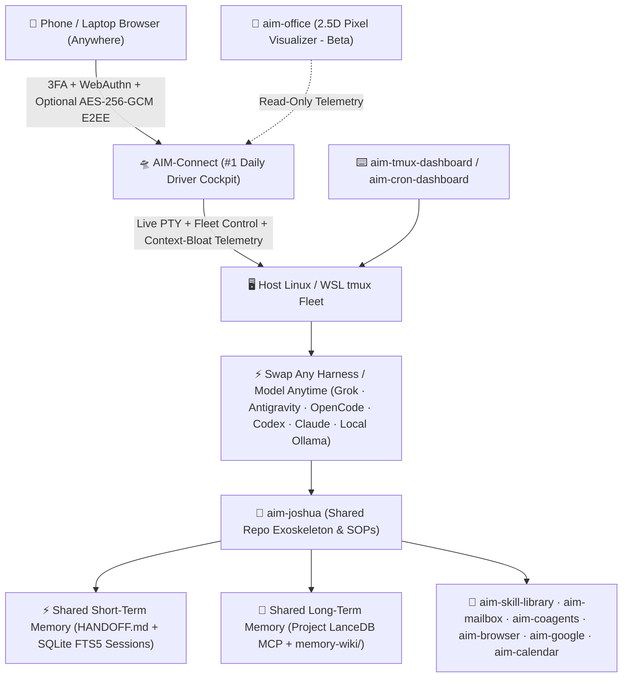

# A.I.M. Ecosystem

**Own your stack. Don't rent a seat.**

**A.I.M. (*Actual Intelligent Memory*)** is a self-hosted, open-source software ecosystem for running, supervising, and auditing long-horizon AI coding agents on your own hardware—from any browser or phone—where **every model and every CLI/IDE harness shares the exact same short-term and long-term project memory (`LanceDB` + `memory-wiki/` + `HANDOFF.md`)** with zero SaaS seat fees or vendor lock-in.

> [!IMPORTANT]
> **Radical Product-Truth Policy (Work in Progress):** This ecosystem is built in the trenches by a working operator to run real daily businesses—not by a VC-funded marketing team. Every repository below carries its **actual build maturity and internal `aim-auditor` grade**. Some tools are battle-tested daily drivers (`aim-connect`, `aim-joshua`), some are newly shipped utilities (`aim-mailbox`), some are active betas or partial phases (`aim-office`, `aim-calendar`), and retired/unbuilt specs (`aim-boardroom`, `aim-chalkboard`) are explicitly archived below. Nothing here pretends to be finished when it isn't.

---

## 🧠 Why This Ecosystem Exists (The Engineering Logic)

Most AI developer tools make the same three mistakes: they lock your workflow inside one vendor's `$20–$200/month` subscription, burn API tokens using LLMs to summarize their own messy logs, and trust black-box "context compression" that lobotomizes the agent halfway through a task.

A.I.M. was built from five opposite first principles:

1. **The #1 Separator — Any Model, Any Harness, One Shared Short-Term & Long-Term Project Brain:** Normally, every AI tool traps your history in its own silo (`~/.gemini/`, `~/.grok/`, `~/.codex/`, `.cursor/`). Switch harnesses or hit a quota wall mid-feature and your next agent wakes up with total amnesia. **[aim-joshua](https://github.com/BrianV1981/aim-joshua)** breaks those silos completely by binding every harness (`Antigravity`, `Grok CLI`, `OpenCode`, `Codex`, `Claude Code`, `Cursor`, or local `Ollama` models) to the **exact same two-tier project memory**:
   - **Shared Short-Term Memory (`HANDOFF.md` + `./aim sessions` SQLite `FTS5`):** Scope a feature in Antigravity at 10:00 AM, seal a structured handoff, and wake up Grok CLI, Codex, or local OpenCode at 10:01 AM with the exact tactical state and searchable session log intact.
   - **Shared Long-Term Memory (`memory_lance/` LanceDB + `memory-wiki/`):** Every installed CLI and IDE auto-connects to the **same local LanceDB hybrid vector + BM25 database** (`search_lancedb` MCP + `./aim search` fallback). What Gemini learns on Monday, Grok, GPT, Claude, or a local Ollama model recalls in milliseconds on Tuesday.
2. **Clientless Sovereignty Over Rented Cloud Seats:** You shouldn't need a `$40/month` cloud IDE, a proprietary desktop app, or private SSH keys stored on a borrowed iPad to control your own Linux server. With **[aim-connect](https://github.com/BrianV1981/aim-connect)**, any mobile or desktop browser becomes a 3FA/WebAuthn-secured root cockpit for your entire `tmux` agent fleet.
3. **The 30% Context Rule (Handoffs Over "Compression"):** A 1M–2M token context window is a trap—past ~30% capacity, attention weights dilute, token burn compounds every turn, and running `/compact` destroys exact variable and architectural recall. Instead of compressing bloated sessions, A.I.M. tracks context bloat visually, curates conscious plain-text Markdown wikis (`memory-wiki/`), and passes tight `HANDOFF.md` batons to fresh `<10%`-context sessions.
4. **Zero-Token Determinism ("Python for Autonomic Work, LLMs for Reasoning"):** An LLM should never do a job that deterministic Python, SQLite `FTS5`, or `git` can do for `$0` in `5ms`. Transcript parsing (`aim-flight-recorder`), local hybrid vector+BM25 recall (`aim-memory` / `mcp_lancedb.py`), and `git worktree` sandboxing happen outside the prompt window—zero background API burn, zero summarizer hallucinations.
5. **Adversarial Verification Over Agent "Trust Me" Claims:** Autonomous agents routinely claim tests pass when they haven't run them. A.I.M. seals raw session transcripts into an Operator-only encrypted **Blackbox Vault** and pairs builder agents with a separate hostile **`aim-auditor`** peer (`aim-coagents` + `aim-skill-library`) that grades repositories empirically (`F` → `A+`) before work is accepted.

### 🤖 The Combined Endgame: A Self-Hosted, Model-Agnostic "Grok Bot"

When you wire **[aim-connect](https://github.com/BrianV1981/aim-connect)** + **[aim-joshua](https://github.com/BrianV1981/aim-joshua)** (+ `aim-coagents`, `aim-cron-dashboard`, and `aim-browser`) together on your own Linux/WSL machine, you end up with a **100% self-hosted, model-agnostic equivalent to xAI's Grok Bot** (and a developer-grade evolution of **OpenClaw**): persistent named AI teammates living 24/7 on a dedicated computer with their own terminal, filesystem, real headed browser, scheduled routines, persistent memory, spoken `🔊` mobile briefings, and `✋ Waiting` chimes when they need human approval.

> [!WARNING]
> **Honest Trade-Off (Steep DIY Curve vs. Total Ownership):** Unlike a 1-click paid subscription like Grok Bot, assembling `aim-connect` + `aim-joshua` + `tmux` + CLI skills has a **steep installation and Linux learning curve**. What you get in return is zero monthly microVM rent, full bare-metal control, and complete **model independence**—run frontier CLIs (`Grok`, `Antigravity`, `Codex`, `Claude Code`) today, or run **100% locally offline** with `OpenCode` + local `Ollama` / `vLLM` models, local `nomic-embed-text` embeddings, and local `piper-tts` ONNX voices.

| Dimension | **`aim-connect` + `aim-joshua` Stack** (`MIT`) | **xAI Grok Bot** (Managed Cloud) | **OpenClaw / Clawdbot** (Self-Hosted Bot) |
| :--- | :--- | :--- | :--- |
| **Setup & Learning Curve** | **Steep DIY** (Linux/WSL + `tmux` + multi-repo wiring) | **1-Click Turnkey** (Managed cloud microVMs) | **Moderate DIY** (Node/Docker + chat-app tokens) |
| **Model & Harness Lock-In** | **100% Model & Harness Agnostic** (Swap any CLI, BYOK, or **100% local Ollama** mid-task) | **Locked to xAI** (Paid SuperGrok subscription) | Single OpenClaw harness (BYOK + local Ollama) |
| **Shared Short-Term + Long-Term Memory** | **Yes — Across Every Harness & Model** (`HANDOFF.md` + `FTS5` short-term + shared local `LanceDB` & `memory-wiki/` long-term) | **Single-vendor cloud memory** (Cannot hand baton to non-xAI CLIs) | Single-agent `SOUL.md` / workspace memory |
| **Primary Interface** | **Full Browser/Mobile Fleet Cockpit** (Live PTY + Split Monaco IDE + Diffs + `🔊` TTS) | Mobile/Web coworker chat + cloud desktop | Chat apps (Telegram, WhatsApp, Discord, Slack) |
| **Engineering & Repo Guardrails** | **Built-In** (`git worktree` gates, `<30%` handoffs, encrypted Blackbox, hostile `aim-auditor`) | General cloud computer sandbox | General life-admin & script automation (`SOUL.md`) |
| **Hardware & Data Residency** | **100% Your Bare Metal / Private Disk (`$0` rent)** | Vendor cloud microVM | Your machine + third-party chat relays |

---

## ⭐ #1 Flagship Daily Driver: [AIM-Connect](https://github.com/BrianV1981/aim-connect)

> **Status:** `🟢 Daily Driver (v1.8.0)` · **Internal Audit:** `Grade A− (160/160 pytest)` · **License:** `MIT` · **Cost:** `$0` (Self-Hosted)

If you only look at one repository in this ecosystem, start with **[aim-connect](https://github.com/BrianV1981/aim-connect)**. It is the top-used tool in the stack every single day—turning any desktop or mobile web browser into a sovereign, zero-install command center for your Linux machine and every autonomous CLI agent running inside `tmux`.

### What Works Today (`v1.8.0`)
- **Clientless Browser SSH & Immortal `tmux` Streams:** Close Safari or Chrome on your phone, drive across town, reopen the PWA, and re-attach to the exact live PTY stream—no SSH keys on client devices and no App Store terminal required.
- **Live AI Fleet Sidebar & Alert Chimes:** Supervise concurrent `Claude`, `Codex`, `OpenCode`, `Grok`, and `Antigravity` sessions with live state detection (`THINKING`, `✋ Waiting` input chimes, `ERROR`, `IDLE`), `Cmd+K` teleportation, and a secret-redacting scrollback **Token Grabber**.
- **Split-Pane Monaco Web IDE, Diff Viewer, & Cross-Fleet Forensics:** Browse files, edit code with `HTTP 409` `mtime` conflict protection, inspect side-by-side Git diffs without unmounting your live terminal, and run instant SQLite `FTS5` searches across structured agent transcripts.
- **Hands-Free `🔊` Neural TTS & Sovereign Mobile Input:** Listen to plain-English spoken agent summaries while away from your desk (`piper-tts` offline ONNX or Edge Neural voices) and type effortlessly on phones using a custom developer keybar (`Tab`, `Esc`, sticky `Ctrl`, pipes) plus programmable voice macros.
- **Zero-Trust 3FA, Passkeys, Client-Side E2EE, & `bwrap` Gateway:** Protected by Stealth Passphrase + Password + TOTP, FIDO2 WebAuthn (**FaceID / TouchID / YubiKey**), optional browser-side `AES-256-GCM` WebSocket encryption, and a multi-tenant Bubblewrap (`bwrap`) sandbox gateway mode.

> [!NOTE]
> **🚧 Active Roadmap (Coming Next to `aim-connect`):** Deeper **Fleet Control** orchestration menus (batch dispatch, lifecycle controls, and multi-agent routing) and richer **Visual Context-Bloat Menus** so you can spot token burn, session saturation, and 30%-Rule handoff thresholds across every running agent at a glance before quality degrades.

### How `aim-connect` Compares to Paid & Existing Alternatives

| Capability | **AIM-Connect** (`MIT`) | **Termius Pro / Blink** (Paid SSH Apps) | **GitHub Codespaces / Coder** (Cloud IDEs) | **Cursor / Vendor Remote** (Locked IDEs) |
| :--- | :--- | :--- | :--- | :--- |
| **Price** | **$0** (100% self-hosted) | `$10–$20/mo` subscription | `$0.18–$0.72/hr` VM compute | `$20–$200/mo` seat + lock-in |
| **Works on Any Borrowed Browser (Zero Install)** | **Yes** (Clientless Web / PWA + 3FA/Passkey) | **No** (Requires native app + local SSH keys) | **Yes** (Cloud hosted) | **No** (Requires vendor desktop/mobile ecosystem) |
| **Multi-CLI AI Fleet Awareness** | **Yes** (`THINKING`/`✋ Waiting` chimes, 30% meters, FTS5 forensics) | **No** (Raw dumb terminal only) | **No** (Single container focus) | **Locked to 1 vendor's agent** |
| **Built-In Split Monaco IDE + Side-by-Side Diff** | **Yes** (Runs against your bare-metal disk) | **No** (SFTP file list only) | **Yes** (Cloud VM disk) | **Yes** (Desktop heavy) |
| **Mobile Dev Keyboard + `🔊` Neural TTS Readback** | **Yes** (Offline Piper ONNX + ghost-free keybar) | Keybar only (no agent TTS) | Poor on mobile browsers | **No** |
| **Browser-to-Host `AES-256-GCM` WS E2EE** | **Yes** (Opaque even to your TLS tunnel) | SSH transport | Vendor terminates TLS | Vendor terminates TLS |

---

## 🧬 Core Exoskeleton: [J.O.S.H.U.A. (`aim-joshua`)](https://github.com/BrianV1981/aim-joshua)

> **Status:** `🟢 Production (v1.1.3 — Deployed Across 21/21 Local Workspaces)` · **Internal Audit:** `Grade A+ (66/66 pytest, Linux + Windows CI)` · **License:** `MIT`

**[aim-joshua](https://github.com/BrianV1981/aim-joshua)** (*Joint Operational Systems for Heuristic User Automation*) is a lightweight, repo-level **agentic exoskeleton** (`joshua_os/` + `./aim` + `AGENTS.md` — automatically `.gitignore`-shielded so it never pollutes your project's commits).

> **Why call a lightweight exoskeleton an "Operating System"?** Yes, that's an intentionally opinionated take—it is obviously not a Linux kernel, and **it does not compete with or replace `Claude Code`, `Cursor`, `Antigravity`, `Grok CLI`, `OpenCode`, or `Codex`**. Those harnesses run *inside* J.O.S.H.U.A. Raw coding agents are powerful brains with terrible operational habits, so J.O.S.H.U.A. acts as an **"Operating Procedure System"**—bolting onto whichever harness or local model you already use to enforce non-negotiable memory, branching, and handoff procedures:

- **Two-Tier Local Hybrid Memory (`mcp_lancedb.py` + `./aim search`):** Auto-registers a workspace-scoped LanceDB vector + Tantivy BM25 `search_lancedb` MCP server across your installed CLIs/IDEs (Windows 10/11, macOS, Linux, WSL) with a deterministic `./aim search` CLI fallback (`0.5s` offline fallback when Ollama is asleep).
- **Conscious GitOps Wiki & Datajack Cartridges (`memory-wiki/` + `.parquet`):** Replaces lossy `/compact` summarizers with agent-curated plain-text Markdown wikis (`memory-wiki/`), structured `<30%`-context `HANDOFF.md` batons, and mountable Apache Arrow `.parquet` knowledge cartridges (`bake`, `jack-in`, `unplug`).
- **Worktree Isolation, Session Notebook, & Encrypted Blackbox Vault:** Enforces isolated `./aim fix <id>` worktrees (`workspace/issue-<id>` → `./aim promote`), indexes past sessions in a local SQLite `FTS5` notebook (`./aim sessions`), and seals raw transcripts into an at-rest Fernet-encrypted vault (`./aim <vessel>-blackbox`).

### How `aim-joshua` Compares to Other Agent Workflow, SOP & Memory Layers

*(Note: Execution harnesses like Claude Code, Cursor, OpenCode, Grok CLI, and Codex are **hosts** that run inside these layers—not competitors.)*

| Capability | **J.O.S.H.U.A. (`aim-joshua`)** | **BMAD-METHOD / GitHub Spec-Kit / Superpowers** (SOP & Spec Kits) | **Beads (`bd`) / Claude Task Master** (Task & State Trackers) | **Mem0 / Zep / Basic Memory** (Agent Memory Layers) |
| :--- | :--- | :--- | :--- | :--- |
| **Primary Role** | **All-in-one repo exoskeleton** (SOPs + Hybrid RAG + GitOps + Vault) | Spec-driven planning, role prompts, & TDD skill discipline | Git-backed task graphs & cross-session issue state | Standalone vector or Markdown MCP memory servers |
| **Pricing** | **$0** (`MIT`, 100% local) | **$0** (`MIT` / Open Source) | **$0** (`MIT` / Open Source) | Free local OSS / `$19–$249/mo` managed cloud (`Mem0`/`Zep`) |
| **Cross-Harness Shared Memory (Short + Long Term)** | **Yes** (`Antigravity`, `Grok`, `OpenCode`, `Codex`, `Claude`, & `Ollama` all share 1 `HANDOFF.md` + `FTS5` log + 1 local `LanceDB`) | Partial (Shared Markdown specs, no shared vector/BM25 DB or FTS5 session log) | Partial (Shared task graph, no shared long-term semantic RAG) | Long-term recall only (No structured short-term baton handoff or SOPs) |
| **Built-In Hybrid Vector + BM25 DB** | **Yes** (Local `LanceDB` + `Tantivy` MCP + `.parquet` cartridges) | **No** (Markdown specs & prompt templates only) | **No** (JSONL / task metadata only) | **Yes** (Core focus, no workflow/GitOps tools) |
| **Enforced `git worktree` CLI Gates** | **Yes** (`./aim fix` → isolated worktree → `./aim promote`) | Prompt-guided / manual git | Task state in git (no worktree promotion engine) | **No** |
| **Structured `<30%` Handoff + FTS5 Session Log** | **Yes** (`HANDOFF.md` + `./aim sessions` SQLite `FTS5` + encrypted Blackbox) | Spec/story files (no encrypted transcript vault) | Strong task continuity (no transcript vault) | **No** |
| **Non-Invasive Consumer `.gitignore` Shield** | **Yes** (`joshua_os/` & `workspace/` auto-shielded; atomic `./aim update`) | Commits `.bmad-core/` or `.specify/` into repo | Commits `.beads/` or `.taskmaster/` into repo | External DB / MCP config only |

---

## 🛠️ Active Ecosystem Tools: Honest Status & Comparisons

Every active repository in the stack is grouped below by what job it solves, its **real completion state**, and how it compares to paid SaaS and existing open-source tools.

### 1. Fleet Cockpits, Schedulers & Visualizers

| Tool | Real Status | Replaces (Paid SaaS) | Replaces (Existing OSS) | Why Use A.I.M. / Honest Caveat |
| :--- | :--- | :--- | :--- | :--- |
| **[aim-tmux-dashboard](https://github.com/BrianV1981/aim-tmux-dashboard)** (`aim-dash`) | `🟢 Daily Driver` (`v1.0.0`) | Warp Teams (`$15–$40/mo`) | `tmux choose-tree`, `tmuxinator` | Instant Python Textual TUI inside SSH/terminal with live ANSI pane previews, AI agent badges across windows, Spotlight git-repo launcher, and zero-friction session resume. |
| **[aim-cron-dashboard](https://github.com/BrianV1981/aim-cron-dashboard)** (`aim-cron`) | `🟢 Daily Driver` (`v0.2.0`) | Cronitor / Healthchecks (`$20+/mo`) | Raw `crontab -e`, Crontab UI | Translates 5-field crons to plain English, pauses/edits/force-runs jobs safely with automatic crontab backups, and tails scheduled agent logs in one terminal TUI. |
| **[aim-office](https://github.com/BrianV1981/aim-office)** | `🟡 Beta / WIP` (`v1.0.0`, Audit `C+`) | LangSmith / AgentOps (`$39–$99/mo` cloud telemetry) | Pixel Agents (VS Code-only extension) | Renders up to 32 live `tmux` agents across 4 isometric 2.5D pixel-art rooms (`80` directional sprites) with 30%-Rule amnesia HUD bars. **Unfinished:** Live Inspector Drawer forensics, Kanban routing, and Vite proxy hardening (`#23`–`#29`) are still in progress. |

### 2. Memory, Transcripts & Personal Exocortex

| Tool | Real Status | Replaces (Paid SaaS) | Replaces (Existing OSS) | Why Use A.I.M. / Honest Caveat |
| :--- | :--- | :--- | :--- | :--- |
| **[aim-memory](https://github.com/BrianV1981/aim-memory)** | `🟢 Stable Library` (`RAG 5.21`) | Mem0 Pro / Zep Cloud (`$19–$249/mo`) | Basic Chroma / naive vector RAG | Standalone Python `MemoryClient` combining LanceDB vectors + Tantivy BM25 FTS + entity-aware reranking (**95.6% Recall@5** on LongMemEval) on local `.parquet` files with `$0` cloud vector hosting. |
| **[aim-calendar](https://github.com/BrianV1981/aim-calendar)** | `🟡 WIP — Phase 1 Live` (`v1.2.0`, Phase 1 Audit `A`) | Limitless / Rewind AI (`$19–$29/mo` cloud lifelog) | Manual XML scripts + scattered notes | Local-first communications exocortex (`32/32` tests): syncs Android SMS/MMS XML backups + call recordings via `rclone`, interleaves diarized call transcripts into Obsidian Daily Notes, indexes into LanceDB, and auto-prunes `190+ GB` of superseded XMLs. **Unfinished:** Phase 2 MMS vision/translation (`#13`) and Phase 3 Gemini + Google Calendar sync (`#14`) are not built yet. |
| **[aim-flight-recorder](https://github.com/BrianV1981/aim-flight-recorder)** | `🟢 Daily Utility` (`v1.0.7`) | Paid LLM log summarizers / token burn | Raw `jq` over multi-MB `.jsonl` caches | Deterministic, zero-token Python extractor turning noisy Antigravity & Grok CLI `.jsonl` transcripts into clean, human-readable Markdown **Flight Records** for audits and post-mortems. |
| **[aim-knowledge](https://github.com/BrianV1981/aim-knowledge)** | `🟢 Public Vault` | Gated AI newsletters / paid courses | Scattered blog posts | Public Obsidian vault containing `130+` architectural notes, post-mortems (*Scribe Suicide*, *The 30% Rule*, *The Great Convergence*), and RAG 5.21 benchmark proofs. |

### 3. Agent Skills, Specialist DNA, Inter-Agent Comms & Automation

| Tool | Real Status | Replaces (Paid SaaS) | Replaces (Existing OSS) | Why Use A.I.M. / Honest Caveat |
| :--- | :--- | :--- | :--- | :--- |
| **[aim-skill-library](https://github.com/BrianV1981/aim-skill-library)** | `🟢 Daily Driver` | Vendor-locked IDE plugin stores | Copy-pasted prompt snippets | Cross-platform Python/PowerShell installer (`Base + Vessel Override`) deploying operational procedures (`aim-audit`, `aim-handoff`, `aim-communicate` `v2.0`, `aim-memory-wiki`, `aim-sessions`, `aim-bwrap-forge`, `aim-calc`) across `agy`, `grok`, `opencode`, and `codex`. |
| **[aim-mailbox](https://github.com/BrianV1981/aim-mailbox)** (`aim-mail`) | `🟢 Live Release` (`v0.1.1`, `15/15` Linux + Windows CI; *Baseline audit pending*) | Hosted multi-agent message buses | Heavy daemon/MCP agent mailers (`mcp_agent_mail`, `agent-relay`) & SQLite-only CLIs | Zero-daemon, zero-LLM, pure-Python stdlib (`0` runtime deps) JSON Maildir post office (`os.replace()`, lock-free across Windows 11 NTFS ↔ WSL2 `/mnt/c` `9P`) and `<5ms` wake dispatcher across Antigravity Desktop Sidecars (works minimized), `agy` CLI, OpenCode HTTP, Grok Build, Codex, VS Code `v1.145+`, and `tmux` (`Enter`-only 1-line doorbell), backing `aim-communicate` `v2.0`. |
| **[aim-coagents](https://github.com/BrianV1981/aim-coagents)** | `🟢 Active DNA Bank` (`1` blueprint local WIP) | Paid specialist AI SaaS seats | CrewAI / AutoGen (token-heavy chat loops) | Reusable Markdown **Personas** (`11` roles) and sovereign specialist **Blueprints** (`aim-auditor`, `python-developer`, `content-node`, `content-wordpress`, `book-coauthor`) that run in isolated workspaces without framework lock-in. |
| **[aim-browser](https://github.com/BrianV1981/aim-browser)** | `🟡 Functional / Packaging Polish` (`v1.3.1`, Hist. Audit `B−`) | Browserbase / Steel (`$20–$99/mo` cloud browsers) | Heavy Puppeteer / headless Playwright | Zero-Puppeteer Node.js CDP client + loopback-only (`127.0.0.1`) **headed** Chromium daemon and agent skill suite—uses your real local desktop browser fingerprint instead of easily-flagged headless drivers. *(Needs minor root `package.json` / CI polish on next pass.)* |
| **[aim-google](https://github.com/BrianV1981/aim-google)** | `🟢 Daily Utility` *(Customized `gogcli` Fork)* | Zapier / Make (`$20–$99/mo` Workspace glue) | Heavy OAuth MCP wrappers | Fast, script-friendly Go CLI for Gmail, Drive, Calendar, Docs, Sheets, and YouTube (customized fork of Peter Steinberger's MIT `gogcli` with A.I.M. YouTube & workflow additions). |

---

## 📊 Benchmarks & Standalone Open-Source Utilities

- **Memory & Debugging Benchmarks:**
  - **[locomo-v2](https://github.com/BrianV1981/locomo-v2)** — Community-corrected, 100% solvable edition of the LoCoMo long-term conversational memory benchmark (fixes 99 ground-truth hallucinations and 82 dead image links).
  - **[locomo-visual-ground-truth](https://github.com/BrianV1981/locomo-visual-ground-truth)** — Visual ground-truth dataset and OCR cache for LoCoMo.
  - **[aim-aerospace-benchmark](https://github.com/BrianV1981/aim-aerospace-benchmark)** & **[aim-benchmark-oracle](https://github.com/BrianV1981/aim-benchmark-oracle)** — Empirical debugging benchmark sandboxes.
- **Standalone Non-A.I.M. Utilities (`GPL-3.0`):**
  - **[Ad-Free-SMS-Backup-Restore](https://github.com/BrianV1981/Ad-Free-SMS-Backup-Restore)** — Clean Android SMS/MMS backup utility (`GPL-3.0`).
  - **[opensitebackup](https://github.com/BrianV1981/opensitebackup)** — Self-hosted website backup and restore pipeline (`GPL-3.0`).

---

<strong>🪦 Deprecated, Consolidated & Legacy Repositories (15 Historical Repos — Click to Expand)</strong>

 

These earlier single-CLI vessels, concept specs, and prototypes were superseded during **The Great Convergence** into **[aim-joshua](https://github.com/BrianV1981/aim-joshua)**, **[aim-skill-library](https://github.com/BrianV1981/aim-skill-library)**, and **[aim-mailbox](https://github.com/BrianV1981/aim-mailbox)**. They remain online solely as historical references:

- **[aim-chalkboard](https://github.com/BrianV1981/aim-chalkboard)** — Early Git-backed async Markdown dropbox PoC ("The Swarm Post Office"); superseded by **[aim-mailbox](https://github.com/BrianV1981/aim-mailbox)** (`aim-mail` CLI + `aim-communicate` `v2.0`).
- **[aim-boardroom](https://github.com/BrianV1981/aim-boardroom)** — Unbuilt `0`-LOC 4-pane moderator concept spec (`VISION_AND_ARCHITECTURE.md`, `INDUSTRY_AUDIT.md`); visual fleet supervision moved into **[aim-connect](https://github.com/BrianV1981/aim-connect)** and **[aim-office](https://github.com/BrianV1981/aim-office)**, while cross-harness message routing shipped in **[aim-mailbox](https://github.com/BrianV1981/aim-mailbox)**.
- **[agy-joshua](https://github.com/BrianV1981/agy-joshua)** *(Archived)* — Legacy Windows 11 PowerShell prototype; merged into `aim-joshua` (`v1.1.0+`).
- **[aim-agy](https://github.com/BrianV1981/aim-agy)** — Legacy Antigravity CLI vessel; superseded by `aim-joshua`.
- **[aim-antigravity](https://github.com/BrianV1981/aim-antigravity)** — Earlier Antigravity IDE-line vessel; superseded by `aim-joshua`.
- **[aim-grok](https://github.com/BrianV1981/aim-grok)** — Legacy Grok CLI vessel; superseded by `aim-joshua`.
- `aim-opencode` *(private)* — Legacy OpenCode CLI vessel; superseded by `aim-joshua`.
- **[aim-codex](https://github.com/BrianV1981/aim-codex)** — Legacy OpenAI Codex CLI vessel; superseded by `aim-joshua`.
- **[aim-claude](https://github.com/BrianV1981/aim-claude)** — Retired Anthropic-line vessel; superseded by `aim-joshua`.
- `aim-skills` *(private)* — Legacy skills index; replaced by `aim-skill-library`.
- **[aim-calc-skill](https://github.com/BrianV1981/aim-calc-skill)** — Standalone calculator skill (`aim-calc` now ships inside `aim-skill-library`).
- **[aim](https://github.com/BrianV1981/aim)** — Original March 2026 Gemini CLI framework.
- **[aim-wiki](https://github.com/BrianV1981/aim-wiki)** — Earlier public Obsidian vault; superseded by `aim-knowledge`.
- **[aim-swarm](https://github.com/BrianV1981/aim-swarm)** — Legacy Python swarm factory.
- **[claw95](https://github.com/BrianV1981/claw95)** — Archived early multi-agent `tmux` proof-of-concept ("Claw95 / Synapse").

